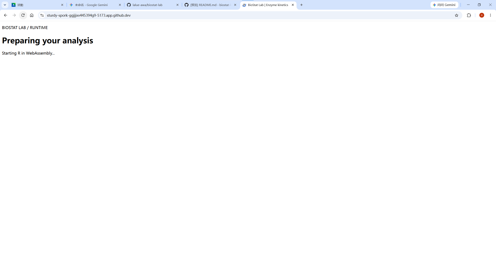
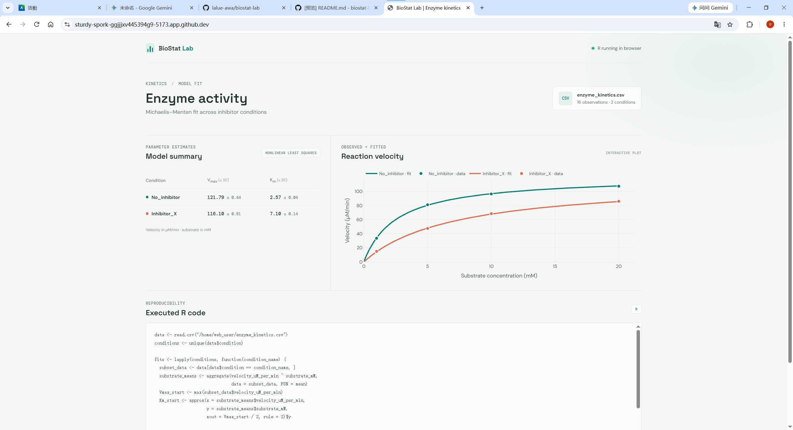

# BioStat Lab - Enzyme Kinetics Analyzer

## App Idea & Biochemistry Research Context
This application automates Michaelis-Menten kinetic analyses ($V_{max}$ and $K_m$) for enzyme inhibition assays directly inside the browser using webR. Screening enzyme inhibitors is a core task in early-stage drug discovery to evaluate drug candidate potency and mechanism of action.

## Screenshots
### App Initial State

### Results Page
